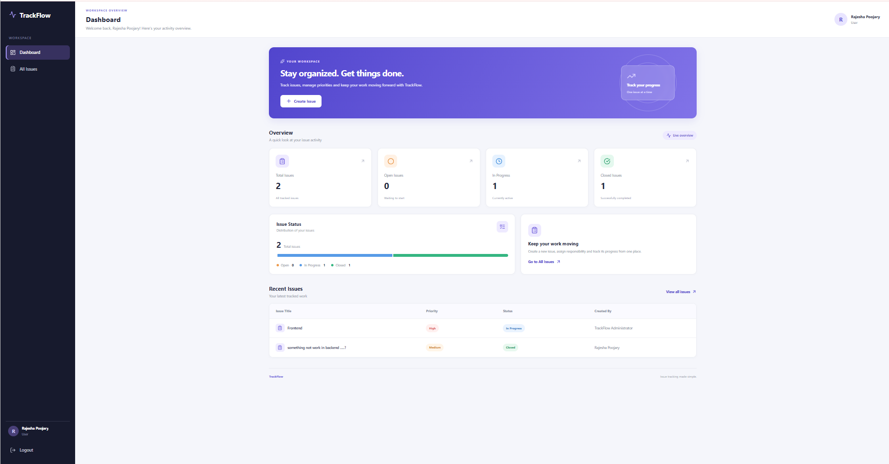
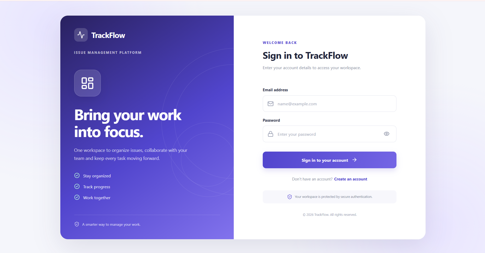
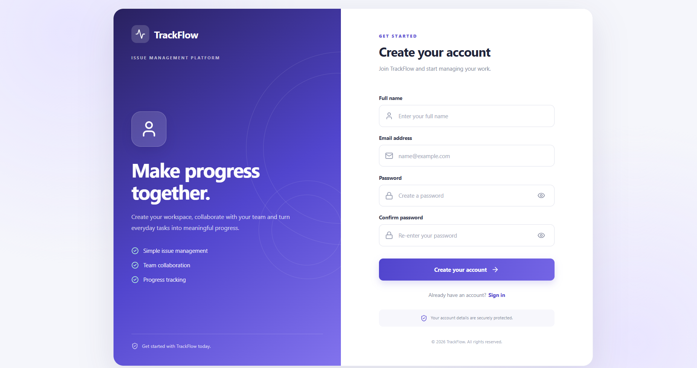
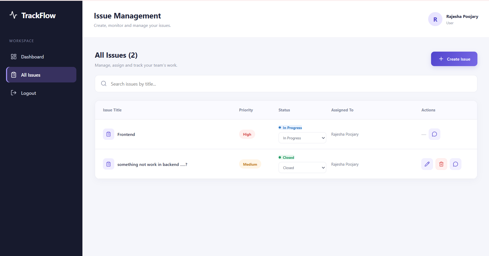
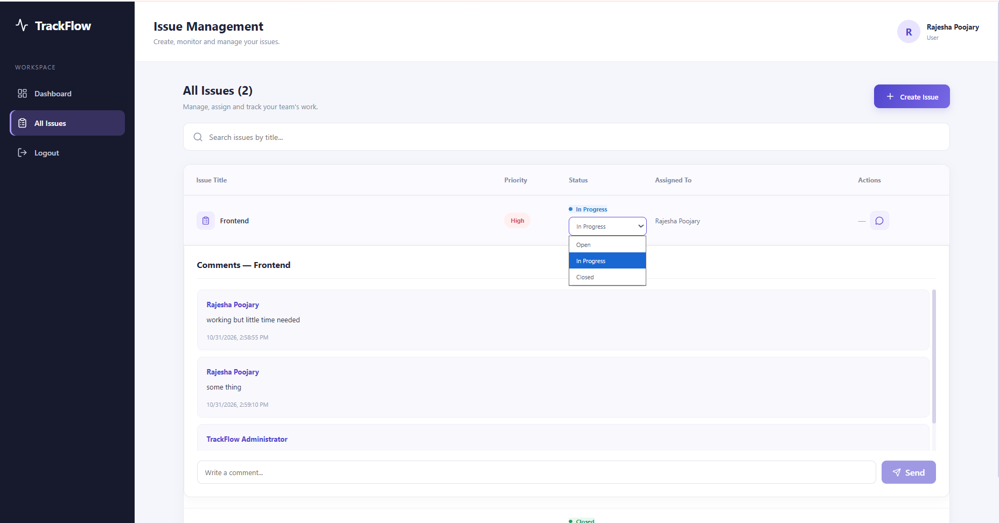
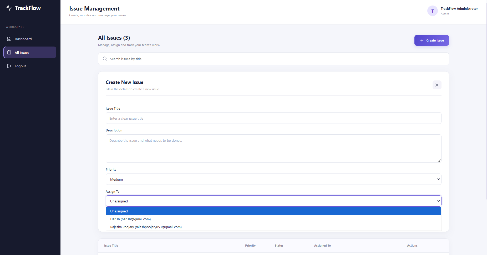

# TrackFlow – Issue Tracker System

<p align="center">
  <strong>A simple, secure and collaborative issue management platform</strong><br>
  Create issues, assign work, track progress and discuss updates in one place.
</p>

<p align="center">
  
</p>

<p align="center">
  
  
  
  
</p>

---

## Table of contents

- [Project overview](#project-overview)
- [Features](#features)
- [Application screenshots](#application-screenshots)
- [Architecture](#architecture)
- [Technology stack](#technology-stack)
- [Project structure](#project-structure)
- [Getting started](#getting-started)
- [Environment variables](#environment-variables)
- [API documentation](#api-documentation)
- [Roles and permissions](#roles-and-permissions)
- [Deployment](#deployment)
- [Future improvements](#future-improvements)
- [Author](#author)

## Project overview

TrackFlow is a web-based Issue Tracker System designed to help teams create, organize and monitor work issues. Users can register, sign in, create issues, update their permitted issue statuses and collaborate through comments. Administrators can manage issues and assign them to registered users.

The application provides a dashboard with issue counts for **Total**, **Open**, **In Progress** and **Closed** issues. The system uses role-based access control so that users and administrators have different permissions.

## Features

- **User registration and login** – create an account and securely sign in.
- **Admin login** – administrators sign in through the login page using an administrator account.
- **Issue management** – create, edit and delete issues according to role permissions.
- **Issue assignment** – administrators can assign issues to registered users.
- **Status tracking** – track issues using Open, In Progress and Closed statuses.
- **Priority levels** – classify issues as Low, Medium or High.
- **Comments** – add and view comments on issues to share progress and updates.
- **Dashboard** – view total issues and counts by status.
- **Search** – search issues by title.
- **Protected API routes** – authenticate requests using JSON Web Tokens (JWT).

## Application screenshots

The screenshots below are stored in `documentation/screenshots/`. Keep the image filenames exactly as shown so that they display correctly on GitHub.

### Login



### Registration



### Dashboard


### Issue management



### Issue comments



### Create and assign an issue



## Architecture

TrackFlow follows a client-server architecture.

1. **React frontend:** displays the login, registration, dashboard and issue management screens. It sends HTTP requests to the backend using Axios.
2. **Node.js and Express backend:** exposes REST API endpoints, validates requests and applies authentication and authorization middleware.
3. **MongoDB database:** stores user accounts, issues and comments using Mongoose models.
4. **JWT authentication:** the backend creates a token after successful login or registration. The frontend sends the token in the `Authorization: Bearer <token>` header when accessing protected endpoints.

### High-level request flow

```text
User
 |
 v
React frontend (Vite)
 |
 | HTTP requests using Axios
 v
Express REST API (Node.js)
 |
 +---- Authentication middleware (JWT)
 |
 +---- Controllers and business logic
 |
 v
Mongoose
 |
 v
MongoDB Atlas
```

## Technology stack

| Layer | Technology |
|---|---|
| Frontend | React |
| Frontend tooling | Vite |
| Routing | React Router |
| HTTP requests | Axios |
| Icons | Lucide React |
| Backend runtime | Node.js |
| Backend framework | Express.js |
| Database | MongoDB Atlas |
| ODM | Mongoose |
| Authentication | JSON Web Token (JWT) |
| Password security | bcryptjs |
| Configuration | dotenv |
| API testing | Browser / Postman (optional) |
| Version control | Git and GitHub |
| Deployment | Vercel (frontend) and Render (backend) |

## Project structure

```text
TrackFlow/
├── backend/
│   ├── config/
│   │   └── db.js
│   ├── controllers/
│   │   ├── authController.js
│   │   ├── issueController.js
│   │   ├── commentController.js
│   │   └── dashboardController.js
│   ├── middleware/
│   │   └── authMiddleware.js
│   ├── models/
│   │   ├── User.js
│   │   ├── Issue.js
│   │   └── Comment.js
│   ├── routes/
│   │   ├── authRoutes.js
│   │   ├── issueRoutes.js
│   │   ├── commentRoutes.js
│   │   └── dashboardRoutes.js
│   ├── seedAdmin.js
│   ├── server.js
│   ├── package.json
│   └── .env                 # Create locally; do not commit
│
├── frontend/
│   ├── src/
│   │   ├── components/
│   │   │   ├── Dashboard.jsx
│   │   │   ├── Dashboard.css
│   │   │   ├── Issues.jsx
│   │   │   └── Issues.css
│   │   ├── App.jsx
│   │   ├── App.css
│   │   ├── Register.jsx
│   │   ├── index.css
│   │   └── main.jsx
│   ├── package.json
│   └── .env                 # Create locally if using Vite env config
│
├── documentation/
│   └── screenshots/
│       ├── login.png
│       ├── register.png
│       ├── dashboard.png
│       ├── issues.png
│       ├── comments.png
│       └── Issue_assign.png
│
└── README.md
```

> If your local project contains additional files, keep them. This structure documents the main application files.

## Getting started

### Prerequisites

Install the following before running the project:

- Node.js (LTS version recommended)
- npm
- Git
- A MongoDB Atlas account or a local MongoDB instance

### 1. Clone the repository

```bash
git clone YOUR_GITHUB_REPOSITORY_URL
cd TrackFlow
```

Replace `YOUR_GITHUB_REPOSITORY_URL` with the HTTPS URL of your GitHub repository.

### 2. Install backend dependencies

```bash
cd backend
npm install
```

### 3. Configure backend environment variables

Create a file named `.env` inside the `backend` folder. Add the variables described in the [Environment variables](#environment-variables) section. Use your own MongoDB connection string and a strong, private JWT secret.

### 4. Start the backend

```bash
npm run dev
```

The backend normally runs at:

```text
http://localhost:5000
```

If your `package.json` does not define a `dev` script, use:

```bash
node server.js
```

### 5. Install frontend dependencies

Open a second terminal:

```bash
cd frontend
npm install
```

### 6. Configure the frontend API URL

Set the frontend API base URL to your backend address. For local development, the current application code uses:

```text
http://localhost:5000/api
```

For production, configure it to use your deployed backend URL. Do not leave the frontend pointing to localhost after deployment.

### 7. Start the frontend

```bash
npm run dev
```

Open the local URL printed by Vite in your terminal, commonly:

```text
http://localhost:5173
```

If that port is already in use, Vite may select another port, such as `5174`.

## Environment variables

Create `backend/.env` locally. Do not upload this file to GitHub.

| Variable | Purpose | Example |
|---|---|---|
| `PORT` | Backend server port | `5000` |
| `MONGO_URI` | MongoDB connection string | `mongodb+srv://<username>:<password>@<cluster-host>/trackflow` |
| `JWT_SECRET` | Secret used to sign JWTs | Use a long random secret |
| `CLIENT_URL` | Frontend origin allowed by CORS | `http://localhost:5173` |
| `ADMIN_NAME` | Administrator display name for seed script | `TrackFlow Administrator` |
| `ADMIN_EMAIL` | Administrator login email for seed script | `admin@example.com` |
| `ADMIN_PASSWORD` | Administrator password for seed script | Use a strong private password |

**Security notes**

- Never commit `.env` files, database passwords, JWT secrets or administrator passwords.
- Add `.env` to `.gitignore`.
- Use a separate strong `JWT_SECRET` in production.
- Configure `CLIENT_URL` with the exact deployed frontend origin.
- If credentials have been exposed, rotate them before deployment.

### Administrator account setup

The backend includes `seedAdmin.js` to create or update the administrator account using `ADMIN_NAME`, `ADMIN_EMAIL` and `ADMIN_PASSWORD` from `backend/.env`.

Run this from the `backend` directory:

```bash
node seedAdmin.js
```

Only run the seed script when the administrator environment variables are configured correctly. Do not publish the administrator password in this README or in source control.

## API documentation

Base URL for local development:

```text
http://localhost:5000/api
```

Protected endpoints require this request header:

```http
Authorization: Bearer <JWT_TOKEN>
```

### Authentication – `/auth`

| Method | Endpoint | Description | Access |
|---|---|---|---|
| `POST` | `/auth/register` | Register a new user | Public |
| `POST` | `/auth/login` | Sign in as a user or admin | Public |
| `POST` | `/auth/admin/login` | Administrator login endpoint | Public |
| `GET` | `/auth/me` | Get the authenticated user's information | Authenticated |
| `GET` | `/auth/users` | List users for assignment | Admin |

### Issues – `/issues`

| Method | Endpoint | Description | Access |
|---|---|---|---|
| `POST` | `/issues` | Create an issue | Authenticated |
| `GET` | `/issues` | Get issues visible to the current user | Authenticated |
| `GET` | `/issues/:id` | Get one issue | Authenticated with access |
| `PUT` | `/issues/:id` | Update an issue | Admin / permitted issue user |
| `DELETE` | `/issues/:id` | Delete an issue | Admin / issue creator |

### Comments – `/comments`

| Method | Endpoint | Description | Access |
|---|---|---|---|
| `POST` | `/comments/:id` | Add a comment to an issue | Authenticated with issue access |
| `GET` | `/comments/:id` | Get comments for an issue | Authenticated with issue access |

Here, `:id` is the issue ID.

### Dashboard – `/dashboard`

| Method | Endpoint | Description | Access |
|---|---|---|---|
| `GET` | `/dashboard/stats` | Get total, open, in-progress and closed issue counts | Authenticated |

### Health check

| Method | Endpoint | Description |
|---|---|---|
| `GET` | `/api/health` | Check whether the backend API is running |
| `GET` | `/` | Backend welcome/status endpoint |

### Example request: create an issue

```http
POST /api/issues
Content-Type: application/json
Authorization: Bearer <JWT_TOKEN>
```

```json
{
  "title": "Login page validation issue",
  "description": "The login form should display a clear validation message.",
  "priority": "High"
}
```

The administrator can also provide an `assignedTo` user ID when creating or assigning an issue, according to the backend permissions.

### Example request: add a comment

```http
POST /api/comments/<ISSUE_ID>
Content-Type: application/json
Authorization: Bearer <JWT_TOKEN>
```

```json
{
  "text": "I have started working on this issue."
}
```

> The endpoint list reflects the routes implemented in this project. For exact response fields and validation rules, refer to the corresponding route and controller files.

## Roles and permissions

| Action | User | Admin |
|---|---:|---:|
| Register an account | Yes | Admin account is seeded |
| Sign in | Yes | Yes |
| Create an issue | Yes | Yes |
| View permitted issues | Yes | Yes – all issues |
| Assign an issue | No | Yes |
| Change status | Own or assigned issues | All issues |
| Edit an issue | Own issues | All issues |
| Delete an issue | Own issues | All issues |
| Add/view comments | Issues they can access | Yes |
| View dashboard counts | Own/assigned issue scope | All issues |

Permissions are enforced by the backend; hiding or disabling a frontend control is not the only security check.

## Deployment

### Hosting plan

The intended deployment setup is:

| Component | Hosting service | Purpose |
|---|---|---|
| Frontend | Vercel | Hosts the React/Vite application |
| Backend | Render | Hosts the Node.js/Express API |
| Database | MongoDB Atlas | Managed MongoDB database |

### Live application links

Update these values after deployment:

- **Frontend:** `ADD_VERCEL_URL`
- **Backend API:** `ADD_RENDER_BACKEND_URL`
- **GitHub repository:** `ADD_GITHUB_REPOSITORY_URL`

### Deploy the database

1. Create a MongoDB Atlas cluster.
2. Create a database user with a strong password.
3. Configure Atlas network access to allow the deployed backend to connect. Prefer a restricted network configuration where possible.
4. Copy the MongoDB connection string.
5. Add it as `MONGO_URI` in the Render backend environment variables.

### Deploy the backend on Render

1. Push the project to GitHub.
2. In Render, create a new **Web Service** and connect the repository.
3. Set the **Root Directory** to `backend`.
4. Set the build command to `npm install`.
5. Set the start command to `npm start` if the backend package defines that script; otherwise use `node server.js`.
6. Add the production environment variables: `MONGO_URI`, `JWT_SECRET`, `CLIENT_URL`, and any administrator seed variables required by your setup.
7. Deploy the service and verify the backend health endpoint at `/api/health`.
8. Use the Render service URL as the frontend's production API base URL.

### Deploy the frontend on Vercel

1. In Vercel, import the GitHub repository.
2. Set the **Root Directory** to `frontend`.
3. Use the Vite build command `npm run build`.
4. Set the output directory to `dist`.
5. Configure the frontend API environment variable if the frontend has been updated to read one (for example, `VITE_API_URL`) and set it to the deployed Render API base URL ending in `/api`.
6. Deploy the frontend.
7. Add the deployed Vercel origin to the backend's `CLIENT_URL` setting and redeploy/restart the backend if required.
8. Test registration, login, issue creation, assignment, status changes, comments and dashboard counts on the live site.

### Updating the deployed application

1. Make and test changes locally.
2. Commit and push the changes to the connected GitHub branch.
3. Vercel rebuilds the frontend when frontend files change.
4. Render rebuilds the backend when backend files change.
5. Check the deployment logs and test the live application after each deployment.

**Important:** This README describes the deployment procedure. Replace the placeholder live URLs only after the services have actually been deployed and tested.

## Future improvements

- Email notifications for issue assignment and status changes.
- File attachments for issues.
- Filters by status, priority and assignee.
- Pagination for large issue lists.
- Activity history and audit logs.
- Automated tests and CI/CD checks.

## Author

**Rajesh Poojary**  
B.Tech – Data Science (Hons)

---

<p align="center">
  Built with React, Node.js, Express and MongoDB.
</p>
